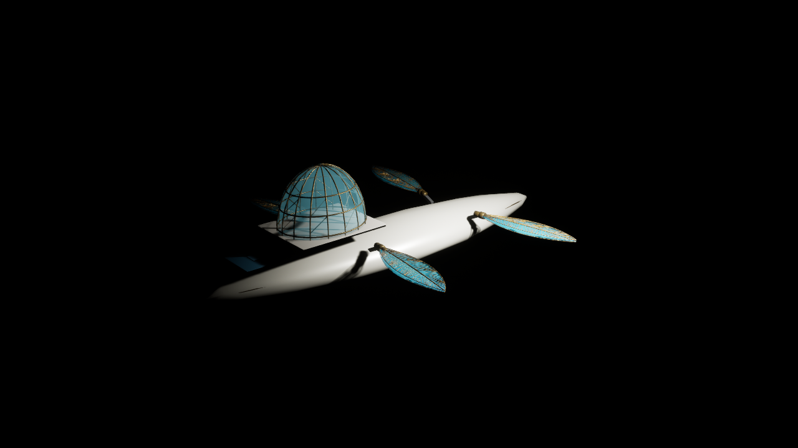

# Aureate Wake — Unreal 5.8.4 native body-pair evidence (November 1, 2026)

**Review only · NOT canonical artwork · No protected merge or release · Orbiter remains fail-closed.**

## Exact provenance and tested scope

- Source head compiled, imported and rendered: `0879685aaac0b947860c9227d5d3b8dfe782b805`, draft [PR #684](https://github.com/ndrorchestration/ToSailtheStarrySky-jrpg/pull/684).
- Native machine: Windows 11, Intel Iris Xe, 16 GB RAM, installed Unreal Engine 5.8.4 and VS 2022 MSVC 14.44.35229.
- Isolation: `C:\Users\Admin\work\TSTSS-UE58-BodyPairNative-20261101`; no live production scenes, user editor, main branch, or unrelated worktree modified. Exact-source asset and import receipts retained outside the worktree under `C:\Users\Admin\work\TSTSS-UE58-BodyPairEvidence-20261101`.
- Initial native build at `1df89a1c...` **FAILED** on one ambiguous `TObjectPtr<UStaticMesh>` conditional and four `TestEqual` type mismatches. Corrected in source commit `0879685a...` using `.Get()` explicitly; retry `ToSailTheStarrySkyEditor Win64 Development` **SUCCEEDED**, UnrealBuildTool process exit 0.
- Native `Automation RunTests TSTSS` at `0879685a...`: **13 succeeded, 0 failed, 0 not-run**, commandlet exit 0, including `TSTSS.Ship.PreviewFormsAndOrbiterHold`. Stored native JSON: `NativeBodyPairAutomationReport/index.json` (local evidence folder). This is real Editor automation, not merely hosted source checks.

## Native asset import

The guarded, manifest-bound pair generated two local noncanonical GLBs and passed both engine-free test suites: 6 generator + 9 importer tests.

| Import candidate | GLB bytes | Source SHA-256 | Native bounds (half-extents, centimeters) | Materials |
| --- | ---: | --- | --- | ---: |
| AureateWake_HullCandidateV1.glb | 190,780 | `abbed9a66529e9a7968bb295bb9adfd20c7877da4cc8839262b78adb4f3ee985` | (520.00, 102.80, 63.43) | 3 |
| AureateWake_BridgeDomeCandidateV1.glb | 214,564 | `82ab4ee8b0ada094317d97a9e835203a3c2519dce3099c24e0f50816fccc88a9` | (119.00, 94.00, 78.08) | 3 |

Unreal's real Interchange importer produced one `StaticMesh` per asset plus three materials and one texture in each independent path under `/Game/TSTSS/Review/ShipArt/{HullCandidateV1,BridgeDomeCandidateV1}`, without modifying existing production assets. Commandlet exit **0**, import log **0 reported errors / 0 reported warnings**. Local import JSON receipt records exact asset paths and source checksums.

For visual integration, the previously reviewed iridescent wing GLB was reimported to `/Game/TSTSS/Review/ShipArt/WingCandidateV2`. This import succeeded but emitted a **near-zero bi-normal warning** for the wing; review geometry/tangent quality remains a defect to address before art acceptance.

## Saved native actor review maps

Local, untracked Unreal content `/Game/TSTSS/Review/Scenes/` contains:
- `AureateWakeSkyborne_BodyPairReviewV1`
- `AureateWakeSeaborne_BodyPairReviewV1`
- `AureateWakeSubmersible_BodyPairReviewV1`

Native Editor Python verified the validated hull and bridge both applied successfully (`IsAuthoredBodyReviewApplied=true`) with exactly **4 wings, 4 root mounts, 2 hydrofoils, 2 hydrofoil struts**, plus an explicitly rejected Orbiter request. Both ordinary-form transitions completed through the editor-only review method and saved. These review scenes are **not** part of gameplay levels or approved art.

## D3D12 screenshot receipts

All three actual 1280×720 Unreal Editor game-mode offscreen renders were captured with the Intel Iris Xe D3D12 RHI, fixed in-map review camera and the imported GLBs. Screenshots are independent of the prior PR #656 images.

| Form | Screenshot SHA-256 | View |
| --- | --- | --- |
| Skyborne | `c6bf3fbbdfc82316ddef2a787df8a7d5e972e467700fb458ba2339092caafa98` | [Skyborne frame](Evidence/AUREATE_WAKE_SKYBORNE_UE584_BODYPAIR_REVIEW_20261101.png) |
| Seaborne | `36f104d79a61d56476a46aca11783a01d4c870eed40b02df42298264404254f9` | [Seaborne frame](Evidence/AUREATE_WAKE_SEABORNE_UE584_BODYPAIR_REVIEW_20261101.png) |
| Submersible | `73672a004f2724b6807029a7309a8534067cde7f7745032105e33a9a199bacbf` | [Submersible frame](Evidence/AUREATE_WAKE_SUBMERSIBLE_UE584_BODYPAIR_REVIEW_20261101.png) |

## Independent visual QA findings — NOT APPROVED

- The four iridescent wings are rendered and respond to all three forms, but **the wing-to-hull proportions are visibly too small** compared to the intended dragonfly-led design. Do not alter approved proportions without creator review; build a controlled side-by-side silhouette study first.
- The white hull and gold/cyan geodesic canopy are visible, but the silhouette is a **simplified procedural study**, not the creator-approved, cinematic Aureate Wake model.
- Seaborne has a visible foil and provisional supporting strut, but the support/hull relationship still looks disconnected or underdeveloped and requires an authored mechanical continuity review.
- The native scene background remains **black** without a convincing ocean, atmospheric horizon or environment, limiting useful cinematic/material assessment.
- The wing GLB import reported near-zero bi-normals; investigate/repair tangent generation without discarding the validated manifold/source identity.
- No continuous swept wing/bridge collision proof, buoyancy, submersion/pressure proof, water shaders, full material/lighting calibration or finished art approval has been established.
- **Orbiter remains locked**; no native Orbiter render, safe transition, or lunar progression unlock is claimed.

## Minimal next slice

1. Create a reproducible approved-reference silhouette comparison at the same camera and hull dimensions before adjusting wings, body, deck or bridge. Keep choices review-only.
2. Correct the wing tangent-space/bi-normal warning, then reimport into a fresh review folder with the same hash/provenance discipline.
3. Improve the Seaborne hydrofoil-to-hull connection and add low-cost sky/sea/environment preview lighting in a separate camera-consistent render slice.
4. Verify six ordinary directed transitions with actual swept geometry clearance, then request creator visual approval. No merge, release or art promotion is authorized by this evidence.

**Evidence PR contains screenshots and this receipt only.** Generated review `.uasset` files and maps remain local to the isolated workstation worktree; the source generator/importer remain in PR #684.
