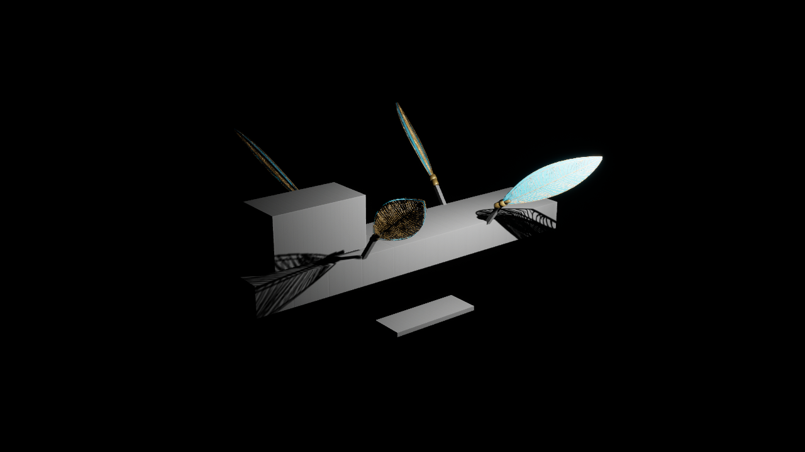
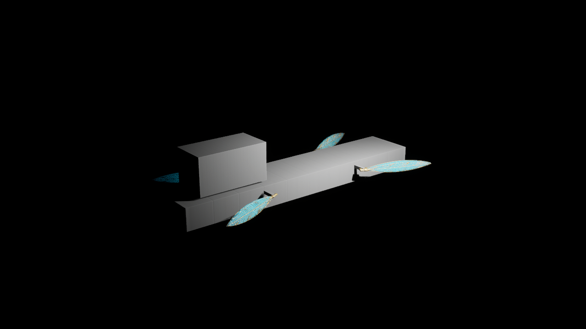

# Aureate Wake — ordinary-form native review continuation (2026-11-01)

**REVIEW ONLY / NONCANONICAL.** This is a small review branch stacked on PR #653 at exact head `a42527b0e69f3e9a2e27fe9e328827aac42e4ab8`, which itself stacks on PR #650. No protected merge, story rewrite, visual approval, art replacement or playable release.

## Changes
- Four independently positioned **temporary wing-root brackets** (`ReviewWingRootBracket_1…4`) visually bridge the current provisional hull side toward the 280-cm authored wing pivots. They are hidden in the default Cube view and for Orbiter. They update during ordinary form transitions, but are **not engineered/approved load-bearing mounts**.
- Two temporary **hydrofoil struts** (`ReviewHydrofoilStrut_1…2`) link the provisional hull to the foil positions while foil meshes are visible. They fold out of view with the hydrofoils; no physics, buoyancy, pressure seal or final art validation is implied.
- `FinishOrdinaryPreviewTransitionForReview()` is an explicit editor review-only action that finishes an *already authorized* ordinary-form transition. It refuses nontransitioning states and transitions into/out of Orbiter; it cannot bypass `RequestForm` gates. Required because `Tick` is not exposed as a Python callable on this native actor.
- Native ship automation checks four wings, two hydrofoils, four wing-root brackets and two hydrofoil struts, routine transitions, refusal of interruption, refusal of unsupported form values and authored-wing Orbiter rejection even when a preview flag is true.

## Verified evidence
- **UE 5.8.4 Editor Win64 native build:** **PASS / exit 0**, including final hydrofoil-strut changes.
- **Native TSTSS automation:** **13 succeeded / 0 failed / 0 not run**, process exit **0**; local evidence `NativeOrdinaryFormAutomationReport/index.json`. Other foundation combat, First Wake and save regressions remain green in this isolated worktree.
- **Source-side wing tests:** **31/31 PASS** across four Python suites (7 + 9 + 7 + 8).
- **Editor save/load creation:** Seaborne `/Game/TSTSS/Review/Scenes/AureateWakeSeaborne_ReviewV2` and Submersible `/Game/TSTSS/Review/Scenes/AureateWakeSubmersible_ReviewV2` were saved successfully from a cloned noncanonical Skyborne lookdev scene. Both reported 4 wings / 2 hydrofoils, correct completed form and Orbiter request rejected. Local receipt `C:\Users\Admin\work\TSTSS-UE58-WingGenerated-20261101\ue58-ordinary-forms-scene-results.json`.
- **Actual Unreal D3D12 HighResShot captures, 1280×720:** [Seaborne](Evidence/AUREATE_WAKE_SEABORNE_UE584_REVIEW_20261101.png) (SHA-256 `7df11a853a970a5e10c4984a87ff490f5099a84aec13a1711282f4b0873ee302`), and [Submersible](Evidence/AUREATE_WAKE_SUBMERSIBLE_UE584_REVIEW_20261101.png) (SHA-256 `b8b88c4a94dd065ee6333b72f1b1e6368192c44f4933fcb182916ffee265e054`). These two images verify **earlier wing-root bracket implementation** and the original hydrofoil positions. They were captured **before the two hydrofoil struts were added**, so they DO NOT show or certify the final strut layout.
- **Post-strut Seaborne screenshot:** attempted in an offscreen D3D12 process; Unreal stalled in engine startup and no capture was produced before the bounded deadline. Only the review process was stopped. **Visual strut confirmation remains OPEN** despite successful compile and native automation.
- All imported `.uasset` files and review `.umap` maps remain isolated **locally** and are not included in this PR. Temporary editor Python plugin and generated project config changes were reverted before commit.

## QA assessment / remaining gates
- Seaborne image clearly reveals **two unresolved problems**: provisional foils appear disconnected without support members (now addressed in C++ review proxy but not visually verified), and the ship hull/bridge are unapproved BasicShapes.
- Wings in Submersible remain visible, preserving the approved visual direction for tucked wing origins; they are not fitted to approved submarine pressure geometry.
- Four root brackets and two foil struts are only proxy pieces. Verify complete motion/clearance and support attachment across all six directed ordinary transitions with real authored geometry; discrete geometric sampling is not continuous collision proof.
- Black scene background is not a designed sky/ocean/undersea environment. Scene lighting and materials are review-grade, not cinematic quality.
- Orbiter remains hidden and unsafe authored transitions remain rejected; no story unlock.
- Next smallest step: verify the new hydrofoil-strut render once GPU/editor is responsive, give ship an actual geodesic-forward-bridge and continuous hull silhouette in an isolated art pass, and reconcile the competing water observer with foundation water-landing authority without changing narrative canon.

**Authority:** Godot still governs the canonical game and story; this branch is a reversible Unreal preview only.
