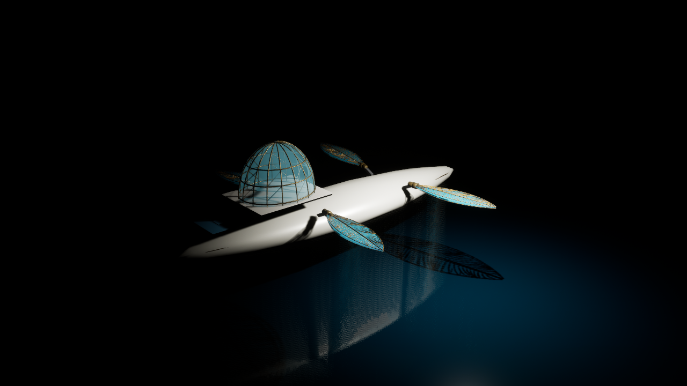

# Aureate Wake — Sky/sea native D3D12 visual HOLD, November 1, 2026

**Status: SOURCE + NATIVE STAGE PASS; CINEMATIC SKY VISUAL FAIL.**

Based on [draft PR #705](https://github.com/ndrorchestration/ToSailtheStarrySky-jrpg/pull/705) and the isolated source branch. Exact source textures generated by `author_aureate_sky_sea_review.py` passed **5/5** Windows tests, were imported by real UE 5.8.4 into `/Game/TSTSS/Review/Environment/SkySeaV1`, and used only in a new review-only map `/Game/TSTSS/Review/Scenes/AureateWakeSkyborne_SkySeaReviewV1`. Native stage commandlet exited 0 with 0 reported errors/warnings. The ship's four wings, previously validated hull/bridge, and denied Starbourne/Orbiter transition were unchanged.

## Genuine D3D12 screenshot

The **second** fixed-camera 1280×720 native Unreal D3D12 screenshot showed the ocean material rendered blue/teal rather than the first frame's gray placeholder. A real shadow/reflection-like ship silhouette was visible on the ocean plane. **The sky remained black** on both frames. This frame is a negative/art-QA HOLD, not an acceptable cinematic scene.

Native read-only Unreal Editor inspection confirmed that the sky sphere was visible, uses an actual two-sided `MSM_UNLIT` emissive material, and has a TextureSample node connected to Emissive. The sea plane is visible with a connected texture Base Color and Roughness. A second game-mode capture shows that material readiness changes results, but a precise cause of the remaining sky failure is **not established**.

A third isolated diagnostic proposed reducing the sphere radius from ~2000m to ~200m in a **new, distinct** review map, not overwriting V1. Its commandlet stalled during Unreal startup under low physical memory (under 0.5 GB available) and did not produce a receipt or saved map. Only **that specifically identified diagnostic process** was stopped to avoid resource contention; user game/editor processes were not terminated. **Do not claim V2 exists or has passed rendering.**

## Next reversible gate

Check whether SkySphere is being culled or clipped from within the fixed review camera and whether the sky's emissive texture shader is ready before screenshot capture. Use isolated editor-only capture with warmup, a verified tighter sky radius or an engine atmosphere sky material; then require two genuine, nonblack 1280×720 D3D12 captures with matched camera before accepting this visual layer. Do not edit the playable First Wake scene, main asset folders, or creator-approved Aureate Wake art; Starbourne remains locked.

This work does not establish physical ocean shading, buoyancy, weather dynamics, auroral routes or full cinematic quality. No public deployment, merge, or approval.
