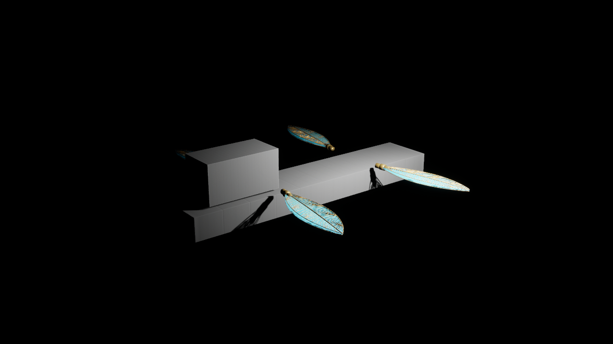

# Aureate Wake — UE 5.8.4 native selective integration and render review (2026-11-01)

**Evidence class: REVIEW-ONLY, NONCANONICAL ART.** Native compiler, automation and imported-mesh proof exist for the *isolated integration candidate*, not the unmodified PR #626 head. No gameplay/release/visual approval is inferred.

## Scope and exact provenance
- Starting native foundation candidate: draft PR #650 at commit `ff146811099f2afd20183d990aecb3c8f54e91e8`, itself layered on foundation PR #608 at `4b85f0d1d7b8870f09d72420871abf4553e3dfbf`.
- Selectively introduced `AAureateWakePreviewActor` header/implementation and wing generator, preflight, geometry audit and source tests from draft PR #626 at `4fc7e6f7235a22346aed9372df2e5e4a0d1a54d2`.
- **Did NOT take** PR #626's older First Wake/combat/save files or `UAureateWakeWaterObserverComponent`. The latter remains an unresolved parallel physics/story authority and must not be blindly combined with the foundation `ATSTSSWaterContactAdapter` and `UTSTSSWaterLandingGate`.
- Candidate local branch: `review/ue58-aureate-visual-20261101`. Godot remains canonical; no production data or mainline merge.

## Native results on Windows / Unreal Engine 5.8.4
1. `ToSailTheStarrySkyEditor Win64 Development` compiled **successfully**: 26 actions, UBT exit code 0. The preview actor was added to the existing compiled foundation module; the follow-up native actor regression test also compiled successfully.
2. Native NullRHI `Automation RunTests TSTSS`: **13 succeeded, 0 failed, 0 not run**; process exit 0; final local report at `NativeFinalAutomationReport/index.json`. This includes 12 foundation regressions plus one new native ship actor test, `TSTSS.Ship.PreviewFormsAndOrbiterHold`. The new test spawns a transient UE world, verifies four wings/two foils, ordinary form changes and interruption denial, and rejects the authored Orbiter request even when review opt-in is true. An initial test-fixture crash was corrected after confirming `UWorld::CreateWorld` already initializes its persistent level and WorldSettings in UE 5.8; the final full suite reran clean.
3. Four imported-wing source test suites: **31 passed** (7 root-pose, 9 GLB-authoring, 7 importer, 8 geometric screen).
4. Corrected one-wing GLB generated locally, SHA-256 `e4d8f99928f5872a73b097ddd89a7a4a1d42a4f856fa8f0496528f35c48d9879`, source centimeters converted to glTF meters (0.01), verified manifest and 2.8m membrane span. Original centimeter-as-meter v1 asset remains disallowed.
5. **Actual Unreal importer**, enabled only in disposable review project, returned one `StaticMesh` with **3 material slots**, texture and material assets, and bounds approximately **296.4 × 93.8 × 18.2 cm** (full X includes rear ferrules). Isolated destination: `/Game/TSTSS/Review/ShipArt/WingCandidateV2`.
6. Editor Python created a local, noncanonical review map with the imported mesh, four persistent wings and two hydrofoils. `bAllowOrbiterPreview` was false, and attempting the authored-wing Orbiter request returned false. Review map V2: `/Game/TSTSS/Review/Scenes/AureateWakeSkyborne_ReviewV2`. No authored sea contact, save, recruitment or progression touched.
7. **Actual UE 5.8.4 D3D12 render** captured with the in-engine `HighResShot 1280x720` command. Better V2 screenshot: [Skyborne native review](Evidence/AUREATE_WAKE_SKYBORNE_UE584_REVIEW_20261101.png), SHA-256 `aa20454766369832b492918ed6f11dc2cce1f9fdeeb86c6dc3f5a26c0c926e89`. The lighting pass reveals the cyan/gold material, but the background remains black and hull and bridge are engine BasicShapes proxies.

## Unresolved acceptance gates
- Approximately **28 cm unconnected wing-root-to-hull gap** still needs authored structural spars; current hull, bridge and foil geometry are proxy-only, with no cinematic art acceptance.
- No native captured evidence for all six *moving* ordinary-form transitions, continuous swept collision, folded-wing interference, hydrofoil buoyancy or water physics. The offline 21-step samples and 19.94 cm conservative clearance are not continuous-time proofs.
- Authored-wing direct Orbiter movement **remains rejected**, even if preview is manually opted in. Orbiter narrative gate and four-sail final art are not playable or approved.
- No finished geodesic dome, ship deck, PBR membrane/solar-sail master material, daylight sky, character models, full First Wake playable level or Windows package.
- Generated Unreal `.uasset` and review `.umap` files remain **only in the isolated local worktree**, not promoted to GitHub production assets. The temporary Python editor plugin switch used for review was reverted before committing.
- The checked and rendered artifact is a **selective integration**, not a claim that draft PR #626 at its exact original head now compiles.

## Next smallest reversible step
Create dedicated actor-runtime automation for ordinary Skyborne/Seaborne/Submersible transitions, verify root attachment supports and snapshot all forms in the native renderer, reconcile water-contact observer ownership with the accepted foundation, then request creator visual review before any gameplay integration.
