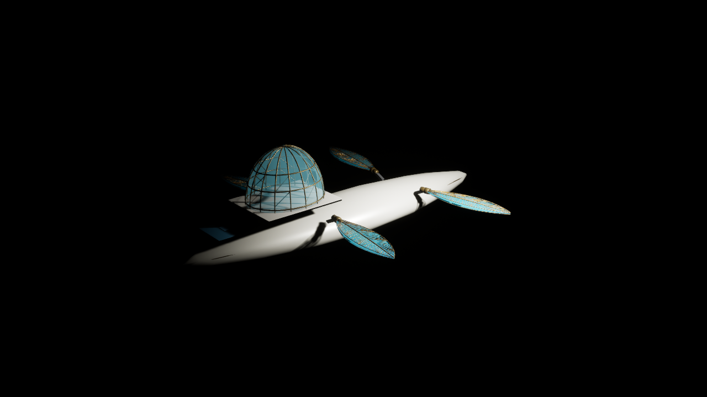

# Aureate Wake — UE 5.8.4 repaired-wing D3D12 visual regression (2026-11-01)

**Evidence only · DRAFT · NONCANONICAL · No art promotion, gameplay change, release or Orbiter unlock.**

## Exact source and scope

- Stack: original native body/wing images [PR #692](https://github.com/ndrorchestration/ToSailtheStarrySky-jrpg/pull/692) → repaired UV generator and tested import [PR #697](https://github.com/ndrorchestration/ToSailtheStarrySky-jrpg/pull/697) at documentation head `119d825568798d1c87eb2103594e956ebb1db7cf`.
- The native UE 5.8.4 Editor Win64 Development/UHT compile passed at `645ea53f7d09e18b246e2b360add8d8a92958010`. Only documentation was added later; the source artifact tested was unchanged.
- Real Unreal Editor `Automation RunTests TSTSS` at `31afcc229950c9a02a5b2a56fc85290dc05489f8`: **13/13 pass, 0 fail, 0 not-run, exit 0**.
- Original source 29,424 wing triangles had **1,798 degenerate UV faces** but no zero-area 3D triangles. Revised source passes complete face-area check, and its **20/20 wing/source/import tests passed** on Windows. The real native Interchange import of the revised GLB to separate `/Game/TSTSS/Review/ShipArt/WingUVRepairCandidateV3` succeeded with one 3-material StaticMesh and the original bounding half-extents **(148.182846, 46.902561, 9.099999) cm**. Original import had **one** `nearly zero bi-normals` warning; revised import had **zero**.
- Revised GLB SHA-256: `099a8133f31faea0b36a64701313a56cfb948066e73ca052b5d61ea214e48490`. Old reviewed mesh remains untouched.

## Native visual regression

Using a **separate, isolated** Unreal 5.8.4 worktree, 18 locally saved review-only original ship/body/wing/map `.uasset` files were copied **byte-identically** (SHA-256 checked) from the previously verified #692 native review checkout. Existing project and approved-art assets were not changed.

New map `/Game/TSTSS/Review/Scenes/AureateWakeSkyborne_WingUVRepairV3` was duplicated from the old private Skyborne map **without overwriting it**. Its single native `AAureateWakePreviewActor` explicitly uses the freshly imported V3 wing. Unreal Editor Python verified **4 wings, 4 root mounts, 2 hydrofoils, 2 struts, authored hull/bridge still applied, Skyborne selected, Orbiter request refused**, and a successful map save.

The fixed-angle 1280×720 **native Unreal D3D12** frame is:

- New frame SHA-256: `f9e7b35e95b9bce24eb4c4115a0344efabda0371c1a94517e4e44688279a7a94`, 161,096 bytes.
- [Original Skyborne frame on PR #692](https://github.com/ndrorchestration/ToSailtheStarrySky-jrpg/blob/75da1c9da22f3081977237c5ea54cbe26bb53a6a/unreal/Docs/Evidence/AUREATE_WAKE_SKYBORNE_UE584_BODYPAIR_REVIEW_20261101.png): SHA-256 `c6bf3fbbdfc82316ddef2a787df8a7d5e972e467700fb458ba2339092caafa98`, 159,704 bytes.
- Both are PNG 1280×720 from the same stored review camera. The repaired screenshot has a distinct hash. Visual inspection finds **no obvious gross silhouette/material regression**, but an automated pixel difference was **not measured** (Pillow unavailable on the workstation). This is **not** an equivalence proof.
- The black environment, undersized-looking wings, simplified hull, and hydrofoil visual continuity problems remain unaddressed. The revised UV model is still a **procedural, noncanonical asset**.

## Review boundaries and next gates

1. Keep the V3 wing import in its **fresh review-only folder** and the old V2 wing and all original three-form screenshots unchanged. New map and imported `.uasset` dependencies remain local only and **are not production source files**.
2. Recheck ordinary-form art with repaired V3 wing in native Seaborne and Submersible scenes if later promoted for artistic review. All six swept transitions, seaworthiness, deck/wing clearances, moon-path Orbiter gate and actual gameplay scene remain separately unverified.
3. A professional dragonfly-led wing proportion study, authored root fairings, panoramic bridge interior, atmospheric/water visual pipeline, creator acceptance and performance profiling are required before claiming cinematic fidelity.
4. No merges, public deployment or canonical-art replacement authorized.

**Only the annotated screenshot and this receipt are committed in this evidence branch.** Native build logs, exact import JSON, staged review map, and regenerated GLB stay private on authorized Windows workstation.
