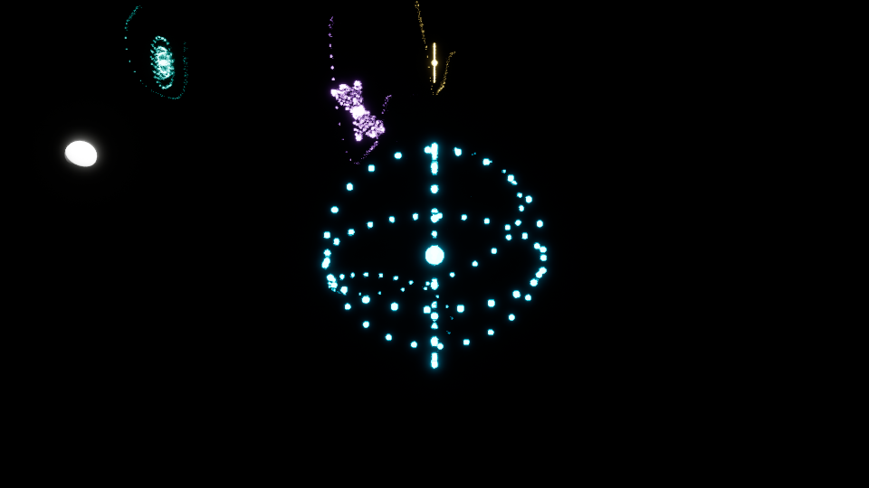

# TSTSS — Ender Resonator magic: vertical-slice source implementation

**Updated 2026-11-13 | DRAFT / UNMERGED / NATIVE AUTOMATION + FIRST GPU SPHERE RENDER VERIFIED / CREATOR REVIEW PENDING / NO SHIPPING APPROVAL**

Authoring checkout: `C:\TSTSS_EnderMagic_20261110` on `feat/ue58-ender-resonator-on-convergence-20261110`.
Primary implementation: Unreal Engine **5.8.4**, not historical Godot.
This document must be read as an evidence boundary, not a claim that the spells
are already castable in the current First Wake playable map.

## Current visual and native evidence: November 13, 2026 (authoritative)

- **Implementation head:** `6e20b044d9174fc6fe4f4b829fabd59b19665719` on draft PR #797, isolated NEONTIC branch. **379/379** engine-free source tests pass, and exact-head Unreal Engine 5.8.4 native verification passed **30/30** automation tests, including `TSTSS.Magic.ResonatorCueContract`, with real Win64 C++ compile/link actions (four UBT actions) and clean-source custody. Receipt: `unreal/Saved/MigrationEvidence/6e20b044d917-20261113T204316759Z-ab656c82/`.
- **Root cause of previous fully black GPU captures:** Unreal Python `Rotator` positional values were supplied in the wrong order, orienting the overview camera straight upward (pitch 90 degrees). Replaced with `MathLibrary.find_look_at_rotation`; the native audit confirmed forward vector toward the review grid. The previous black-camera evidence remains preserved as historical FAIL, not the current result.
- **Reproducible isolated review cameras:** 3x3 overview remains available; a separate default Player-0 Resonant Pulse close-up camera focuses on cue coordinates with 70-degree FOV. Neutral review lighting was lowered and the editor-only scale-reference floor is hidden from gameplay capture. This does not touch production levels or gameplay.
- **Native D3D12 GPU visual evidence:** `unreal/Saved/MigrationEvidence/ResonatorUnobstructedPulseGPU-20261113T154047/ScreenShot00005.png` shows the initial three glowing latitude hoops; `unreal/Saved/MigrationEvidence/ResonatorSphereGPU-20261113T154408/ScreenShot00006.png` shows the corrected cyan three-axis spherical shell, with 72 luminous ring instances and 32 orbital motes. Both are real 960x540 Unreal GPU screenshots. The comparison and SHA-256 receipts are at `unreal/Saved/MigrationEvidence/ResonatorSphereVisualComparison-20261113.json`; the final image contains 4,064 unique colors and 2,593 cyan-emissive pixels by the bounded pixel classifier. This demonstrates **actual rendering**, not creator approval.
- **Spherical cue geometry:** for Resonant Pulse alone, three great circles (XY equator, XZ and YZ meridians) share one normalized time-dependent expanding radius, matching its sphere-distributed motes. Other spell-cue styles and the authorization gates were unchanged. A single captured frame does **not** prove temporal expansion quality, accessibility, atmosphere, stability, frame time or creator acceptance.
- **Remaining visual holds:** repeated time-separated captures / visual animation review, all nine effects in context, controlled exposure and framing, daylight/night/weather/biome readability, sound, actor/weapon animation, performance, gameplay PIE and creator approval. The visible current effect is review-only prototype art, not AAA cinematic approval.
- **Gameplay holds:** Resonant Pulse still has an enemy-actor-only combat row and has **not** gained point/area mechanic permissions; Centering's full-party physical-defense buff (~3 rounds or 10-12 seconds) is **not implemented** in the battle system. Both require distinct authorization-preserving runtime contracts and native tests. No default learned skills, hidden ship forms or production claims were promoted.

### Reviewable native screenshot (not approved)



This is the actual 960x540 native GPU frame from implementation commit `6e20b044d9174fc6fe4f4b829fabd59b19665719`, image SHA-256 `45124e25a8444ac267a12ea5c2386df7aeae3a3b51b32897db65b0b6a46e8c39`. It is a review-only close-up of the sphere visual, not a playable spell, time-series proof, or creator art approval.

## Creator identity and admission gates

Ender's permanent profession is **Harmonic Resonance Engineer**. His selected
vertical-slice **combat job** is **Resonator**. Its full eligible curricula:
Resonance/Harmonic, Correspondence, Psychic/Psion and Synergy/Combination.
His innate magical specialties are separately Aether, Resonance/Harmonic,
Correspondence and Lumen. Five Lights **Spirit** is a narrative affiliation,
not an automatic spell unlock or synonym for the Resonator job.

The design rows in `DataSource/Magic/EnderResonator.vertical_slice.review.json`
all use `ReviewExecutable` **only for an explicitly learned, mastered, equipped,
isolated combat review**. This is intentionally NOT `CreatorApproved` for shipping,
not a default learned set, and not a blanket new class mastery grant. New numerical
power, MP and cooldown values are engineering proposals, pending creator balancing.
The existing `FTSTSSBattleSkillSystem::TryUseDataTable` must authorize a combat
transaction; learning and independent school mastery remain necessary. Psychic
curriculum eligibility **does not** grant Psychic mastery. Synergies require both
named school mastery gates. The current combat executor supports damage/healing,
not arbitrarily invented buffs, teleports, statuses, fields or world interaction.

## Authored review spell suite

| Spell | Family | Review action | 3D visual silhouette | Gate |
|---|---|---|---|---|
| Resonant Pulse | Resonance | **enemy-target review damage only; area/point mechanic NOT integrated** | expanding caster-centered blue spherical pulse VFX | Resonance 1 |
| Tuning Lance | Resonance | enemy damage | traveling cyan spear core and harmonic rings | Resonance 2 |
| Echo Mend | Resonance | living ally heal | green restoring concentric pulse | Resonance 1 |
| Correspondence Thread | Correspondence | enemy damage | violet threaded orbit and target linkage | Correspondence 1 |
| Lattice Break | Correspondence | enemy damage | purple fractured impact rings | Correspondence 2 |
| Mind Ripple | Psychic/Psion | enemy damage | amber twisting psychic motes and ripple | Psychic 1, explicitly learned |
| Focus Harmonic | Psychic/Psion | self heal | golden compact focus orbit | Psychic 1, explicitly learned |
| Concordance Burst | Synergy | enemy damage | wide jade/cyan harmonic discharge | Resonance 2 + Correspondence 1 |
| Thought Chord | Synergy | enemy damage | rose-gold harmonic/psychic cross-phase burst | Resonance 2 + Psychic 1 |

Spell names, color coding and effect styles are review propositions, not final lore.
No unearned Aether or Lumen combat kit, Spirit-only school, advanced vessel feat,
ship unlock, Starbourne mechanic, or Wise Woman/Rift Scholar magic is implied.

## Runtime source and rendering

- `ATSTSSResonatorVfxActor`: genuine Unreal 3D actor, using instanced sphere
  meshes for 3 spatial rings (72 points), 32 orbiting motes, 1 energetic core,
  animated transforms and a colored local point light. Nine distinct parameterized
  spell-style mappings. Transient, bounded 2.15–2.45-second nonloop casts.
- `M_ResonatorGlow`: Unreal Editor Python asset-builder defines an additive,
  emissive shader with `Tint`/`Glow` parameters. BasicShapeMaterial is the
  degraded visual fallback until the shader is imported.
- `DT_EnderResonatorReview`: Editor generator imports the source-locked JSON as
  `FTSTSSBattleSkillRow` DataTable. No existing assets are overwritten.
- `L_EnderResonatorCueReview`: isolated **3 by 3** in-game PIE preview stage,
  one continuously looped VFX actor per candidate. It does not cast spells,
  spend MP, recruit characters, mutate savegames or modify First Wake levels.
- `SpawnFromAcceptedCue` is the C++ **post-success integration point**. The
  existing authorized combat action returns `FTSTSSBattleSkillCue` only on
  success. The renderer checks the exact Ender actor/skill/VFX mapping and
  never mutates combat state. A future runtime battle scene must invoke this
  point **only after** a true `TryUseDataTable` success with exact row and
  learned/mastered state. No current live caller is claimed.

### Build/import in the isolated checkout

1. Ensure no Unreal Editor, UnrealEditor-Cmd, Live Coding or another agent build
   is using the workstation. Require at least 5 GiB free RAM and 14 GiB free disk
   before running the repository's native verifier.
2. Commit the source candidate before `Verify-Unreal.ps1` to bind exact-head
   build and automation receipts.
3. Native compile: `powershell -File unreal/Tools/Verify-Unreal.ps1 -EngineRoot "C:\Program Files\Epic Games\UE_5.8" -ExpectedHead <full-40-char-SHA>`.
4. Only after a clean native build, run Unreal Editor Python script:
   `unreal/Tools/build_ender_resonator_preview.py` with the isolated
   `unreal/ToSailTheStarrySky.uproject`. Validate the DataTable importer, shader
   compile, review level save, native preview PIE and nine per-cue rendered captures.
5. Run `TSTSS.Magic.ResonatorCueContract`, existing
   `TSTSS.Combat.MagicAndWeaponTechniques`, full native automation, dedicated
   GPU frame-time budget and front/side/overhead cinematic screenshots.
6. Review effect contrast in daylight, night, rain, snow, fog, indoor lighting
   and with player/camera movement; check color-blind distinguishability,
   photosensitivity/bloom limits, platform scalability, spatial audio,
   mesh LOD, spell telegraph readability and screen-space UI collisions.
7. Only after approval: wire actual combat DataTable, separately authorized
   learnt and mastered starting loadout, actor caster/target transforms, staff
   cast animation montages and sound; prove active-party continuity and save/load.

## 2026-11-13 native and GPU evidence addendum (supersedes historical source-only claims)

- Governance: draft PR #797 remains **open, unmerged, review-only and non-shipping**; no content is integrated into the playable First Wake scene. Starbourne remains gated. No unearned abilities were learned or granted.
- The isolated Unreal preview material `M_ResonatorGlow.uasset`, nine-row `DT_EnderResonatorReview.uasset` and nine-cue `L_EnderResonatorCueReview.umap` were created and committed on the review branch. The DataTable importer reported **0 problems** after explicitly writing the optional default fields.
- UE Editor Python asset readback confirmed nine exact DataTable names, nine placed preview VFX actors with nine exact cue IDs, an accessible material, and nine loop-enabled review actors.
- `M_ResonatorGlow` was recompiled and saved with the Instanced Static Mesh material usage bit enabled. Unreal logged `RESONATOR_REVIEW_MATERIAL_USAGE_PASS before=False after=True shader_errors=0`.
- A neutral, noncanonical calibration floor and two lights were added **only** to the isolated review level. Review camera Player 0 activation was verified. No gameplay/world maps or production content were changed.
- Native UE **5.8.4** C++/UHT build performed actual compile/link actions at `1bf6d39fc50d20fe5787b181231bad0535896121` and succeeded; exact-head 30/30 named Unreal automation results were accepted with a clean-worktree receipt at `unreal/Saved/MigrationEvidence/1bf6d39fc50d-20261113T200911365Z-ba2accf6/`. These results precede the calibration-only review-map commit `684c82801d4d868ab26f28672c5ecd6418c8b178` and this documentation update.
- Full Python source suite at calibration-map commit: **375/375 PASS**. Source and tests are necessary but never sufficient for rendered visual approval.
- **VISUAL_GATE_FAIL_BLACK_CAPTURE (historical, superseded by current non-black GPU evidence above):** the first GPU capture displayed the unrelated First Wake prelude HUD on black; explicit GameModeBase removed the HUD, but all four later 960x540 D3D12 GPU captures were **exactly RGB (0,0,0) in every pixel** (one unique color), including delayed on-screen and offscreen captures and the calibration stage. Formal pixel report: `unreal/Saved/MigrationEvidence/ResonatorGPU-visual-gate-20261113.json`. Latest screenshot: `unreal/Saved/MigrationEvidence/ResonatorCalibratedGPU-20261113T151445/ScreenShot00002.png`. **Do not promote visual state, approve the cue, or claim cinematic appearance** from these outputs.
- Runtime diagnostic did prove the correct review CameraActor view target, 72 ring mesh instances, 32 motes, and `MID_M_ResonatorGlow_0` on Resonant Pulse. These facts **do not establish that any pixels of the effect are drawn**. The next focused QA must inspect game viewport rendering/show flags, active camera transform and projection, scene primitive visibility, and the actual render target before changing art.
- Gameplay reconciliation remains **BLOCKED / NOT IMPLEMENTED**: the Resonant Pulse visual expands spherically but the combat row still uses single `Target=Enemy` rather than authorized point/area gameplay targeting. The requested `Centering` party physical-defense buff (3 rounds / approximately 10-12 seconds) is not in this nine-cue catalog or current combat executor. Correspondence spells remain deferred from priority completion. Implement buff and point-area contracts separately with authorization, no auto-unlock, explicit tests and native evidence.
- Outstanding art gates: nonblack runtime GPU capture, nine-cue visual readout, daylight/night/atmosphere/contrast/photosensitivity review, staff montage and sound, interactive authorized casting, performance evidence, and creator approval. Never conflate a passing native automation test with a passed rendered scene.

## Validation and remaining blockers

Run engine-free tests:

```powershell
python unreal/Tools/test_ender_resonator_magic_source.py -v
python unreal/Tools/check_unreal_test_inventory.py
python unreal/Tools/check_automation_registry.py
python -m py_compile unreal/Tools/build_ender_resonator_preview.py
```

The test counts and original source-only claims above were historical. The
2026-11-13 addendum is authoritative for subsequent native/asset evidence and
the still-failing rendered visual gate. The renderer is native instanced geometry,
not Niagara. Its cue IDs can be preserved if a future replacement is approved.
No interactive casting, sound, performance, gameplay integration, production art,
or cinematic approval has been established.
